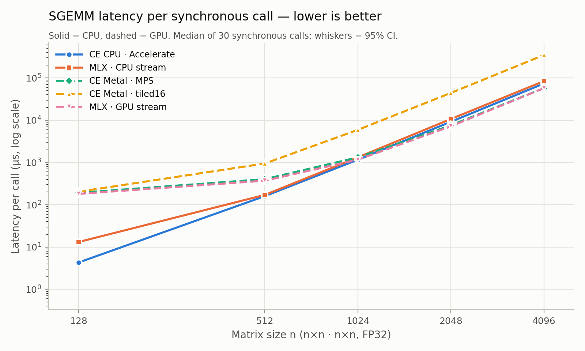
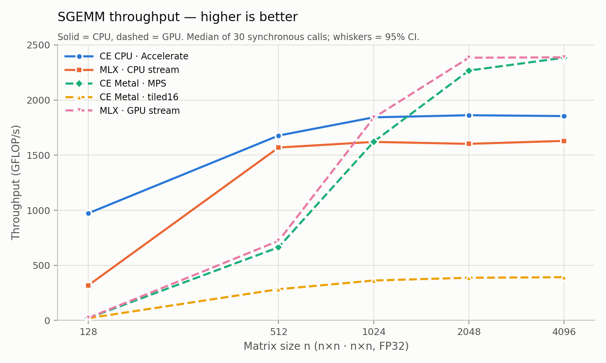

# M4 baseline comparison: FP32 SGEMM

Machine: Apple M4 (Mac16,12), macOS 26.4.1 (25E253), AC Power. Sources: `sources.json`.

Cells give the median latency per synchronous call, with GFLOP/s in parentheses. The bootstrap 95% CIs are in `comparison.csv`.

| n | CE CPU · Accelerate | MLX · CPU stream | CE Metal · MPS | CE Metal · tiled16 | MLX · GPU stream | fastest (ties: overlapping 95% CIs) |
|---:|---:|---:|---:|---:|---:|---|
| 128 | 4.3 µs (973) | 13.2 µs (319) | 192.3 µs (22) | 203.5 µs (21) | 181.3 µs (23) | **CE CPU · Accelerate** |
| 512 | 160.0 µs (1,678) | 171.1 µs (1,569) | 404.3 µs (664) | 947.3 µs (283) | 371.7 µs (722) | **CE CPU · Accelerate** |
| 1024 | 1.17 ms (1,843) | 1.33 ms (1,620) | 1.32 ms (1,622) | 5.93 ms (362) | 1.17 ms (1,840) | **CE CPU · Accelerate** ≈ MLX · GPU stream |
| 2048 | 9.22 ms (1,862) | 10.72 ms (1,603) | 7.58 ms (2,268) | 44.35 ms (387) | 7.21 ms (2,384) | **MLX · GPU stream** |
| 4096 | 74.11 ms (1,855) | 84.34 ms (1,630) | 57.65 ms (2,384) | 350.34 ms (392) | 57.56 ms (2,388) | CE Metal · MPS ≈ **MLX · GPU stream** |

## What each series measures

- **CE CPU · Accelerate**: `matmul()` with Accelerate `cblas_sgemm`, including output allocation. C++.
- **MLX · CPU / GPU stream**: `mx.eval(mx.matmul(a, b, stream=…))` from Python. This includes graph construction, output allocation from MLX's buffer cache, dispatch, synchronisation and Python overhead.
- **CE Metal · MPS / tiled16**: `metal::matmul_into()` with NoCopy storage into a pre-allocated output, including encode, commit and waitUntilCompleted. C++.

These are end-to-end per-call costs as each API is used. They are not kernel-only times; see the `metrics_summary.csv` of the Metal run for the phase breakdown.
