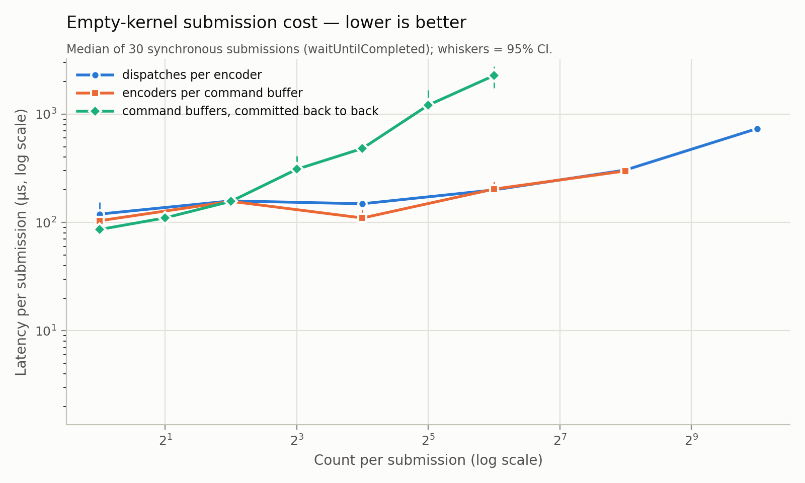
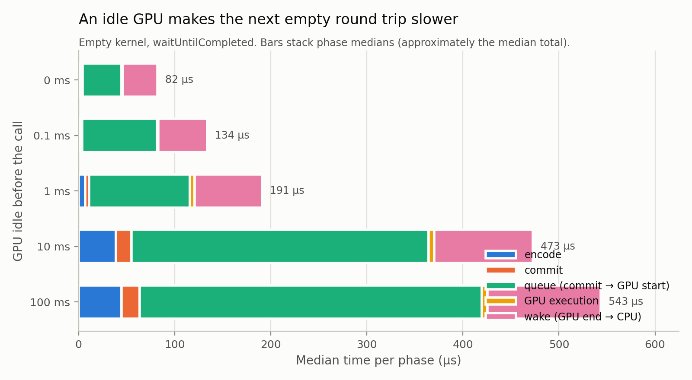
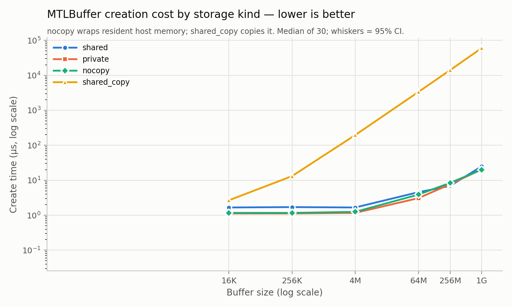
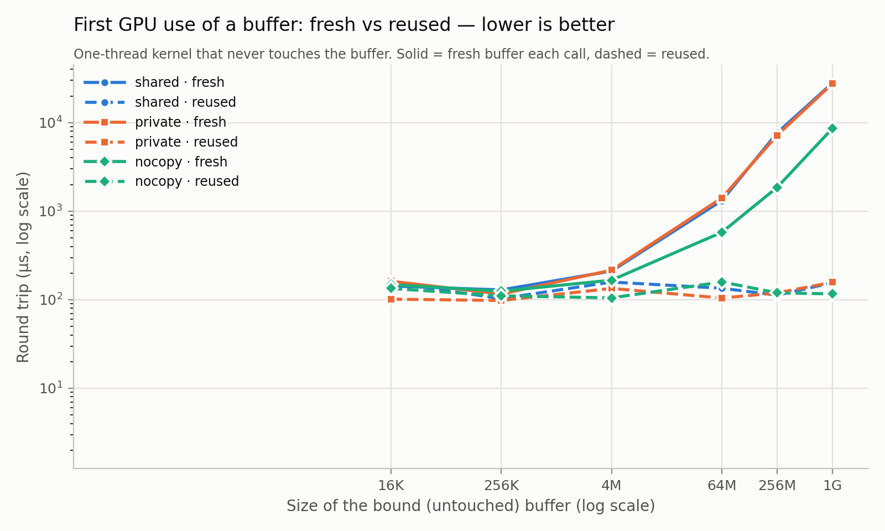
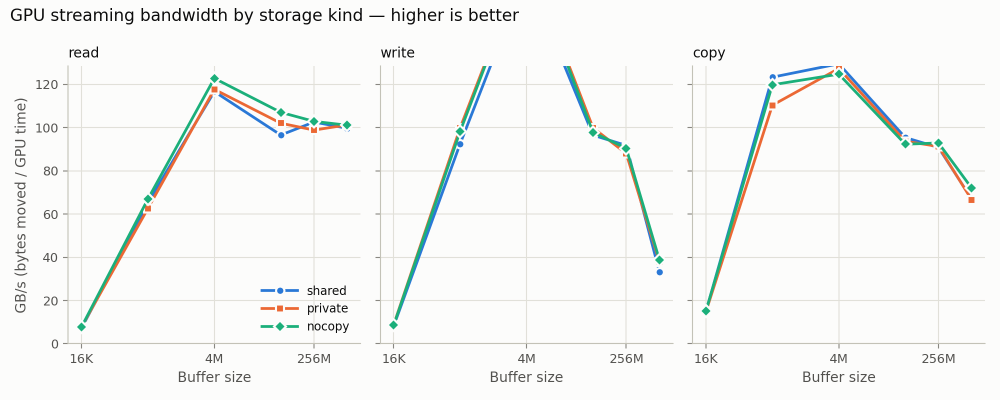

# M5 characterization: dispatch, synchronization and storage modes

Machine: Apple M4 (Mac16,12), macOS 26.4.1 (25E253), AC Power. Runs: `sources.json`. Every number is a median of 30 calls unless stated; CIs are bootstrap 95% CIs of the median.

## Track A1–A2: dispatch overhead

Empty kernels (one thread, no memory access), so all time is runtime overhead.

Marginal cost per added unit (least-squares slope over the medians):

| added unit | total µs/unit | encode µs/unit | commit µs/unit | GPU µs/unit | fitted fixed cost (total, µs) |
|---|---:|---:|---:|---:|---:|
| dispatches per encoder (1 encoder, 1 command buffer) | 0.58 | 0.078 | 0.000 | 0.405 | 146 |
| encoders per command buffer (1 dispatch each) | 0.70 | 0.140 | 0.002 | 0.392 | 127 |
| command buffers, committed back to back (1 encoder, 1 dispatch each) | 35.18 | 5.026 | 0.774 | 20.566 | 22 |

Breakdown of a single empty round trip (1 command buffer, 1 encoder, 1 dispatch), medians in µs. The same configuration is measured once per sweep, so the rows also show within-run drift:

| sweep | total | encode | commit | queue | GPU | wake |
|---|---:|---:|---:|---:|---:|---:|
| dispatches | 119.2 | 2.4 | 1.4 | 55.9 | 1.4 | 52.7 |
| encoders | 103.5 | 2.4 | 1.5 | 49.6 | 1.4 | 48.4 |
| cmdbufs | 85.9 | 2.5 | 1.5 | 41.5 | 1.3 | 38.9 |

Cold start (first empty dispatch in the process, one sample): total 1,497.1 µs, of which library + pipeline compile 1,335.2 µs (OS shader cache state not controlled) and queue 1,222.2 µs.

## Track A3: synchronization methods

Wake = CPU resumes − GPUEndTime; with event methods the event is signalled inside the command buffer, so wake can be slightly negative. Median wake latency in µs, one column per run (runs differ in method order):

**wake latency** (µs):

| work | method | run 1 | run 2 | run 3 |
|---|---|---:|---:|---:|
| empty | wait_until_completed | 48.3 [45.0, 50.2] | 63.6 [63.2, 64.5] | 64.3 [58.7, 74.5] |
| empty | event_wait | 34.9 [33.0, 36.4] | 47.4 [45.4, 59.6] | 53.7 [50.4, 56.7] |
| empty | completion_handler | 41.3 [39.8, 44.6] | 70.0 [66.7, 75.0] | 56.6 [54.9, 65.2] |
| empty | spin_event | 39.0 [35.9, 42.5] | 38.6 [37.6, 39.5] | 39.0 [38.0, 39.5] |
| empty | spin_status | 43.3 [42.7, 46.2] | 38.9 [37.1, 40.7] | 42.6 [42.0, 43.2] |
| 4M | wait_until_completed | 134.8 [110.5, 143.1] | 117.0 [112.6, 120.4] | 150.4 [148.7, 151.8] |
| 4M | event_wait | 91.7 [89.8, 92.5] | 109.0 [105.6, 110.3] | 110.1 [106.7, 111.4] |
| 4M | completion_handler | 95.2 [93.2, 96.5] | 151.5 [150.8, 151.8] | 124.2 [123.9, 125.6] |
| 4M | spin_event | 103.6 [102.3, 104.1] | 99.0 [98.0, 100.1] | 107.0 [106.2, 107.8] |
| 4M | spin_status | 120.5 [118.2, 121.7] | 105.9 [105.5, 106.7] | 104.1 [102.7, 104.5] |
| 256M | wait_until_completed | 144.8 [142.3, 148.0] | 163.2 [159.6, 171.5] | 155.6 [152.3, 161.3] |
| 256M | event_wait | 130.4 [127.6, 135.6] | 138.9 [135.3, 143.6] | 143.4 [139.9, 145.4] |
| 256M | completion_handler | 142.9 [135.7, 154.5] | 164.5 [159.0, 168.0] | 159.4 [156.5, 162.0] |
| 256M | spin_event | 118.0 [113.7, 121.4] | 112.7 [111.0, 115.1] | 110.4 [107.4, 112.4] |
| 256M | spin_status | 134.0 [128.4, 137.7] | 126.1 [123.6, 128.4] | 128.6 [124.6, 130.4] |

**total round trip** (µs):

| work | method | run 1 | run 2 | run 3 |
|---|---|---:|---:|---:|
| empty | wait_until_completed | 121.9 [102.0, 135.3] | 155.3 [150.4, 158.1] | 155.7 [145.0, 179.8] |
| empty | event_wait | 84.4 [82.2, 86.3] | 131.8 [106.0, 155.1] | 138.8 [123.5, 148.1] |
| empty | completion_handler | 91.9 [87.0, 96.4] | 160.9 [141.9, 174.6] | 117.5 [114.3, 132.5] |
| empty | spin_event | 108.3 [95.9, 120.7] | 112.8 [96.5, 123.6] | 120.8 [94.9, 124.4] |
| empty | spin_status | 108.4 [101.2, 120.0] | 92.2 [90.7, 96.0] | 97.2 [94.2, 101.7] |
| 4M | wait_until_completed | 238.4 [210.3, 259.1] | 230.6 [226.2, 235.1] | 306.5 [285.9, 312.4] |
| 4M | event_wait | 194.4 [181.6, 203.9] | 218.9 [214.9, 221.7] | 229.3 [225.0, 232.9] |
| 4M | completion_handler | 174.6 [170.8, 179.3] | 314.7 [304.3, 318.8] | 244.1 [242.1, 249.2] |
| 4M | spin_event | 253.4 [252.3, 255.5] | 216.8 [214.5, 219.5] | 256.5 [254.7, 260.6] |
| 4M | spin_status | 272.9 [270.6, 282.3] | 228.4 [225.1, 230.4] | 214.3 [213.3, 215.1] |
| 256M | wait_until_completed | 3,696.2 [3,591.5, 3,862.7] | 3,170.6 [3,140.5, 3,262.1] | 3,198.6 [3,101.7, 3,275.6] |
| 256M | event_wait | 3,699.9 [3,585.9, 3,930.8] | 3,183.2 [3,107.1, 3,293.5] | 3,138.2 [3,083.7, 3,193.8] |
| 256M | completion_handler | 3,877.7 [3,621.9, 4,105.5] | 3,188.6 [3,117.9, 3,256.3] | 3,220.2 [3,150.4, 3,292.7] |
| 256M | spin_event | 3,560.8 [3,481.2, 3,897.8] | 3,235.8 [3,149.9, 3,297.2] | 3,189.2 [3,046.2, 3,262.9] |
| 256M | spin_status | 3,558.8 [3,487.8, 3,867.9] | 3,160.8 [3,082.4, 3,229.9] | 3,130.7 [3,059.6, 3,225.5] |

Method order per run: run 1: wait_until_completed, event_wait, completion_handler, spin_event, spin_status; run 2: spin_status, spin_event, completion_handler, event_wait, wait_until_completed; run 3: event_wait, spin_status, wait_until_completed, spin_event, completion_handler

## Track A4: idle gap before a submission

Untimed sleep before every call; empty kernel. Medians in µs.

| sync | idle gap | total | encode | commit | queue | GPU | wake |
|---|---:|---:|---:|---:|---:|---:|---:|
| spin_event | 0 ms | 117.6 | 2.9 | 1.2 | 68.1 | 5.0 | 39.7 |
| spin_event | 0.1 ms | 142.5 | 2.4 | 1.1 | 91.2 | 5.1 | 43.0 |
| spin_event | 1 ms | 244.5 | 11.6 | 5.6 | 157.6 | 5.3 | 61.2 |
| spin_event | 10 ms | 768.0 | 86.5 | 14.9 | 570.4 | 6.1 | 80.7 |
| spin_event | 100 ms | 526.5 | 55.0 | 8.3 | 391.1 | 5.8 | 58.5 |
| wait_until_completed | 0 ms | 83.5 | 2.5 | 1.6 | 40.6 | 1.3 | 36.1 |
| wait_until_completed | 0.1 ms | 132.5 | 2.2 | 1.4 | 78.0 | 1.4 | 50.9 |
| wait_until_completed | 1 ms | 215.0 | 6.9 | 4.2 | 104.5 | 5.2 | 70.1 |
| wait_until_completed | 10 ms | 480.7 | 38.7 | 16.3 | 309.2 | 5.9 | 102.8 |
| wait_until_completed | 100 ms | 581.7 | 44.9 | 18.7 | 356.0 | 6.1 | 117.7 |

## Track B: storage modes

### B1: buffer creation and release

Median create / release time in µs:

| size | shared | private | nocopy | shared_copy |
|---:|---:|---:|---:|---:|
| 16K | 1.7 / 1.0 | 1.1 / 0.6 | 1.2 / 0.5 | 2.7 / 1.5 |
| 256K | 1.7 / 1.0 | 1.1 / 0.6 | 1.2 / 0.5 | 13.1 / 2.2 |
| 4M | 1.7 / 0.8 | 1.2 / 0.6 | 1.2 / 0.5 | 196.3 / 15.5 |
| 64M | 4.6 / 10.7 | 3.1 / 2.0 | 3.9 / 2.7 | 3,357.1 / 249.2 |
| 256M | 6.9 / 11.6 | 7.7 / 6.0 | 8.4 / 6.3 | 14.1 ms / 1,275.1 |
| 1G | 25.0 / 17.4 | 20.4 / 12.3 | 20.0 / 11.8 | 60.2 ms / 9,445.2 |

### B2: CPU first touch and warm bandwidth

GB/s (bytes / median time). First write = memset of freshly created memory (page faults); warm = the same memory again.

| size | kind | first write | warm write | warm read |
|---:|---|---:|---:|---:|
| 16K | host | 131.1 | 131.1 | 131.1 |
| 16K | shared | 19.2 | 131.1 | 78.4 |
| 16K | nocopy | 131.1 | 131.1 | 131.1 |
| 256K | host | 95.3 | 99.9 | 93.9 |
| 256K | shared | 22.6 | 88.6 | 79.6 |
| 256K | nocopy | 74.9 | 71.5 | 99.9 |
| 4M | host | 124.9 | 125.0 | 113.1 |
| 4M | shared | 21.6 | 81.7 | 78.6 |
| 4M | nocopy | 121.9 | 121.6 | 111.1 |
| 64M | host | 91.2 | 91.2 | 67.9 |
| 64M | shared | 19.0 | 45.9 | 64.5 |
| 64M | nocopy | 90.5 | 90.4 | 67.8 |
| 256M | host | 77.2 | 77.1 | 64.8 |
| 256M | shared | 19.0 | 45.3 | 65.9 |
| 256M | nocopy | 77.1 | 77.1 | 64.8 |
| 1G | host | 74.2 | 74.2 | 66.6 |
| 1G | shared | 19.6 | 43.3 | 67.1 |
| 1G | nocopy | 73.9 | 74.1 | 66.3 |

### B3: first GPU use (residency) vs reuse

Median total / queue in µs:

| size | shared fresh | shared reused | private fresh | private reused | nocopy fresh | nocopy reused |
|---:|---:|---:|---:|---:|---:|---:|
| 16K | 143.0 / 81.6 | 157.1 / 87.7 | 161.8 / 91.7 | 101.5 / 46.6 | 148.3 / 85.2 | 134.0 / 69.2 |
| 256K | 129.0 / 65.8 | 102.8 / 46.5 | 115.8 / 58.8 | 98.0 / 46.6 | 124.9 / 64.5 | 110.7 / 52.7 |
| 4M | 210.7 / 151.1 | 158.3 / 87.9 | 215.8 / 151.3 | 134.1 / 67.8 | 166.3 / 103.0 | 104.9 / 49.1 |
| 64M | 1,320.0 / 1,244.0 | 134.8 / 71.5 | 1,412.1 / 1,331.3 | 104.5 / 48.8 | 578.2 / 502.2 | 158.6 / 87.3 |
| 256M | 7,656.1 / 7,496.5 | 112.5 / 53.3 | 7,198.4 / 7,109.9 | 119.4 / 59.5 | 1,855.8 / 1,769.9 | 119.6 / 60.2 |
| 1G | 28.0 ms / 27.8 ms | 155.5 / 85.3 | 27.5 ms / 27.4 ms | 157.2 / 88.7 | 8,576.1 / 8,351.0 | 116.4 / 60.3 |

### B4: GPU streaming bandwidth

GB/s from GPUStart–GPUEnd (copy counts read + write):

| size | read shared | read private | read nocopy | write shared | write private | write nocopy | copy shared | copy private | copy nocopy |
|---:|---:|---:|---:|---:|---:|---:|---:|---:|---:|
| 16K | 7.1 | 7.7 | 7.7 | 8.2 | 8.7 | 8.6 | 14.8 | 14.8 | 15.1 |
| 256K | 65.2 | 62.6 | 66.9 | 92.5 | 99.9 | 98.3 | 123.4 | 110.4 | 119.8 |
| 4M | 116.7 | 117.7 | 122.8 | 171.3 | 179.4 | 179.0 | 129.6 | 127.4 | 124.8 |
| 64M | 96.6 | 102.1 | 107.1 | 96.5 | 99.9 | 97.8 | 95.4 | 93.7 | 92.4 |
| 256M | 102.6 | 98.9 | 102.9 | 91.8 | 88.0 | 90.4 | 90.8 | 91.3 | 92.9 |
| 1G | 99.7 | 101.3 | 101.1 | 33.2 | 37.9 | 38.7 | 66.9 | 66.6 | 72.0 |
