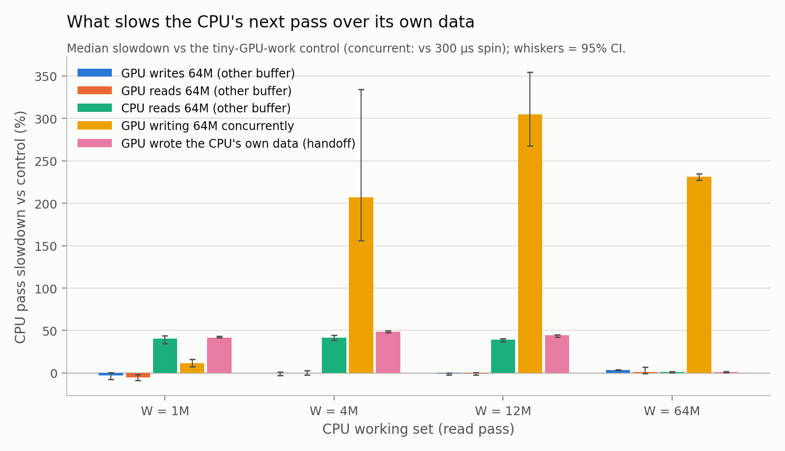
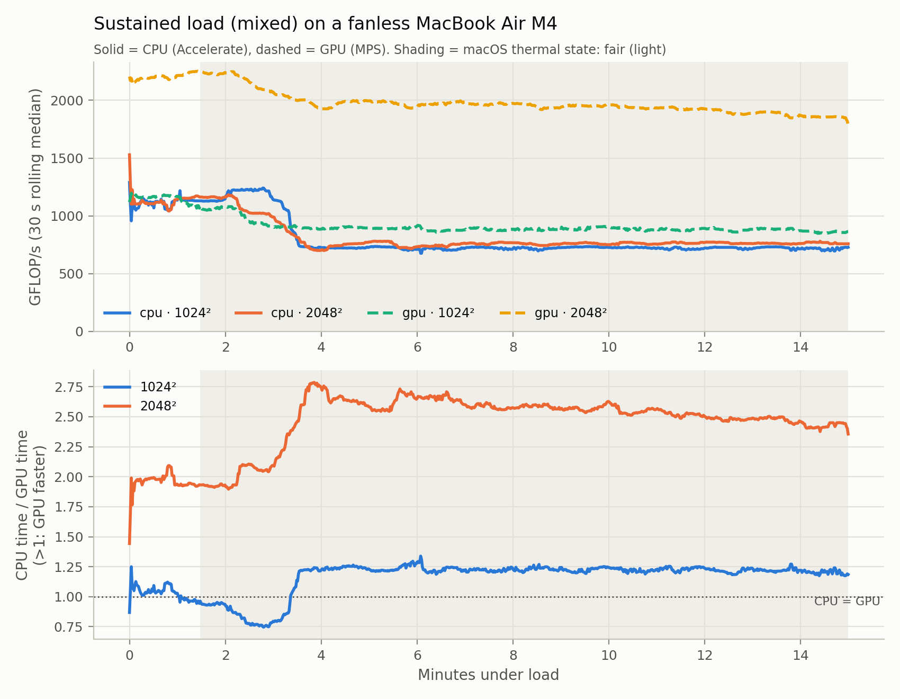
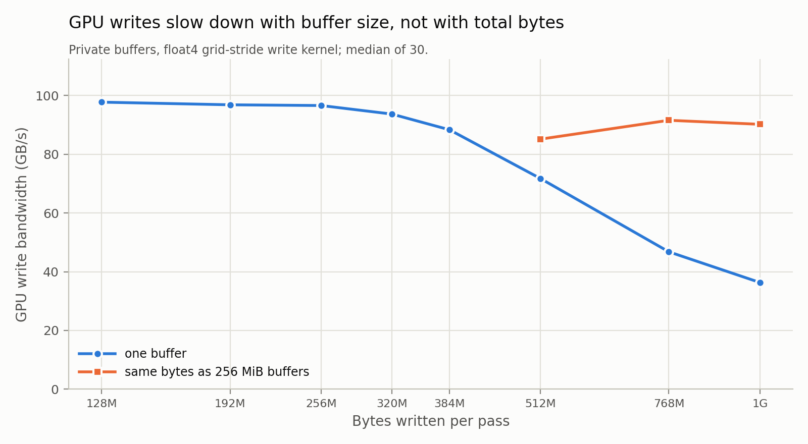

# M6: cache interference, thermal drift, and follow-ups

Machine: Apple M4 (Mac16,12), macOS 26.4.1 (25E253), AC Power. Runs: `sources.json`.

## RQ3: does GPU work slow the CPU's next pass?

Timed CPU pass after an untimed interference phase. Slowdowns are median CPU-pass time vs the control named in each column, with bootstrap 95% CIs. **Bold** = CI excludes zero.

Controls: *tiny* = same submit-and-poll CPU path with negligible GPU memory traffic and the same duration; *spin* = plain CPU spin for the same duration; *short* = 300 µs spin.

| pass | W | G | tiny vs spin | GPU writes G vs tiny | GPU reads G vs tiny | CPU reads G vs tiny | GPU concurrent vs short | overlap |
|---|---:|---:|---:|---:|---:|---:|---:|---:|
| read | 1M | 16M | **+25% [+24, +27]** | **-4% [-5, -3]** | **-4% [-5, -3]** | **-12% [-13, -11]** | **+160% [+151, +195]** | 100% |
| read | 1M | 64M | **+28% [+24, +34]** | -3% [-8, +0] | **-5% [-9, -2]** | **+40% [+35, +44]** | **+12% [+8, +16]** | 100% |
| read | 1M | 256M | **+19% [+15, +24]** | +2% [-2, +9] | +4% [-2, +7] | **+47% [+42, +54]** | **+34% [+20, +43]** | 100% |
| read | 4M | 16M | **+22% [+21, +23]** | **-3% [-3, -2]** | -0% [-1, +0] | **-8% [-8, -6]** | **+123% [+117, +161]** | 100% |
| read | 4M | 64M | **+16% [+11, +21]** | -0% [-3, +1] | -0% [-2, +3] | **+42% [+39, +44]** | **+207% [+156, +334]** | 100% |
| read | 4M | 256M | **+13% [+8, +18]** | +2% [-4, +6] | **+6% [+1, +10]** | **+42% [+38, +46]** | **+44% [+35, +57]** | 100% |
| read | 12M | 16M | **+9% [+6, +11]** | **+4% [+2, +5]** | +2% [-0, +3] | **+17% [+15, +19]** | **+138% [+116, +163]** | 100% |
| read | 12M | 64M | **+8% [+7, +11]** | -1% [-2, +0] | -1% [-2, +0] | **+39% [+37, +41]** | **+305% [+268, +354]** | 77% |
| read | 12M | 256M | **+7% [+5, +8]** | -1% [-2, +1] | +1% [-2, +17] | **+44% [+43, +47]** | **+311% [+274, +347]** | 100% |
| read | 64M | 16M | **+1% [+1, +2]** | **+4% [+3, +5]** | **+1% [+0, +1]** | +0% [-0, +0] | **+185% [+179, +194]** | 97% |
| read | 64M | 64M | **+2% [+1, +2]** | **+3% [+3, +4]** | +1% [-1, +7] | **+1% [+0, +1]** | **+231% [+227, +235]** | 10% |
| read | 64M | 256M | +1% [-2, +3] | **+3% [+2, +3]** | -1% [-2, +1] | **+2% [+1, +2]** | **+238% [+235, +243]** | 100% |
| sgemm | 3M | 16M | **+0% [+0, +1]** | +0% [-0, +1] | -0% [-0, +0] | **+14% [+13, +16]** | **+64% [+49, +67]** | 100% |
| sgemm | 3M | 64M | **+3% [+1, +3]** | **-1% [-1, -0]** | -0% [-1, +0] | **+18% [+17, +19]** | **+158% [+154, +477]** | 100% |
| sgemm | 3M | 256M | +1% [-1, +1] | -0% [-1, +0] | -0% [-1, +0] | **+20% [+19, +21]** | **+17% [+7, +27]** | 97% |

Handoff (read pass only): the GPU writes the CPU's own W buffer, then the CPU reads it.

| W | CPU pass after control (µs) | after GPU wrote it (µs) | slowdown vs tiny |
|---:|---:|---:|---:|
| 1M | 10.3 | 14.6 | **+42% [+41, +43]** |
| 4M | 40.6 | 60.2 | **+48% [+47, +50]** |
| 12M | 123.1 | 178.1 | **+45% [+42, +45]** |
| 64M | 960.7 | 972.1 | **+1% [+1, +2]** |

## RQ4: thermal drift under sustained load

Load: `mixed`; one synchronous call per workload per ~1 s cycle. Medians per minute; the ratio column is CPU time / GPU time (>1 means the GPU is faster, 1 = crossover).

| minute | thermal (most common) | CPU 1024² ms | GPU 1024² ms | ratio 1024² | CPU 2048² ms | GPU 2048² ms | ratio 2048² | empty GPU round trip µs |
|---:|---|---:|---:|---:|---:|---:|---:|---:|
| 0 | nominal | 1.90 | 1.84 | 1.04 | 15.26 | 7.80 | 1.96 | 200 |
| 1 | fair | 1.90 | 2.00 | 0.95 | 14.78 | 7.66 | 1.93 | 201 |
| 2 | fair | 1.77 | 2.31 | 0.77 | 16.85 | 8.12 | 2.08 | 206 |
| 3 | fair | 2.93 | 2.40 | 1.22 | 23.12 | 8.74 | 2.64 | 228 |
| 4 | fair | 2.97 | 2.40 | 1.24 | 22.58 | 8.63 | 2.62 | 216 |
| 5 | fair | 2.97 | 2.41 | 1.23 | 22.93 | 8.73 | 2.62 | 219 |
| 6 | fair | 2.99 | 2.46 | 1.22 | 22.79 | 8.69 | 2.62 | 216 |
| 7 | fair | 2.96 | 2.44 | 1.22 | 22.53 | 8.72 | 2.58 | 217 |
| 8 | fair | 2.98 | 2.42 | 1.23 | 22.85 | 8.84 | 2.58 | 219 |
| 9 | fair | 2.94 | 2.38 | 1.23 | 22.67 | 8.77 | 2.58 | 215 |
| 10 | fair | 2.97 | 2.44 | 1.22 | 22.55 | 8.87 | 2.54 | 214 |
| 11 | fair | 2.98 | 2.42 | 1.23 | 22.29 | 8.94 | 2.49 | 215 |
| 12 | fair | 2.97 | 2.45 | 1.21 | 22.59 | 9.09 | 2.48 | 215 |
| 13 | fair | 2.95 | 2.45 | 1.21 | 22.59 | 9.13 | 2.47 | 214 |
| 14 | fair | 3.01 | 2.51 | 1.20 | 22.51 | 9.32 | 2.42 | 217 |

Time in each thermal state: nominal 1.5 min (10%), fair 13.5 min (90%)
First entry: nominal at 0.0 min, fair at 1.5 min

## Follow-ups on open M5 findings

### Finding 7: does wake latency grow with bytes written (cache writeback)?

Spin on MTLSharedEvent. Medians in µs.

| size | read: GPU time | read: wake | write: GPU time | write: wake |
|---:|---:|---:|---:|---:|
| 1M | 10 | 44 | 18 | 85 |
| 4M | 58 | 80 | 53 | 101 |
| 16M | 213 | 117 | 207 | 110 |
| 64M | 629 | 100 | 670 | 105 |
| 256M | 2522 | 101 | 2783 | 110 |

### Finding 14: CPU write rate by memory source (warm, 64 MiB)

GB/s from medians.

| source | memset | store loop | read |
|---|---:|---:|---:|
| memalign | 89.3 | 89.1 | 66.3 |
| mmap | 90.1 | 89.5 | 66.4 |
| shared | 89.8 | 89.3 | 66.4 |
| shared_wc | 73.2 | 73.3 | 3.4 |
| nocopy_mmap | 89.6 | 89.1 | 65.8 |

Successive memsets into newly created memory (GB/s; memalign/nocopy reuse allocator pages):

| source | write 1 | write 2 | write 3 | write 4 |
|---|---:|---:|---:|---:|
| shared | 20.2 | 47.0 | 73.4 | 73.5 |
| nocopy | 73.1 | 73.0 | 72.9 | 72.9 |
| memalign | 73.4 | 73.4 | 73.4 | 73.4 |

### Finding 15: GPU write bandwidth, one buffer vs 256 MiB chunks

GB/s = bytes / GPU time (two-pass: per pass).

| size | one buffer | one buffer, 2nd pass in same CB | as 256 MiB buffers |
|---:|---:|---:|---:|
| 128M | 97.7 | 97.2 | — |
| 192M | 96.8 | 95.9 | — |
| 256M | 96.6 | 94.4 | — |
| 320M | 93.7 | 94.0 | — |
| 384M | 88.3 | 88.9 | — |
| 512M | 71.7 | 71.3 | 85.1 |
| 768M | 46.8 | 46.8 | 91.5 |
| 1G | 36.3 | 36.5 | 90.2 |

