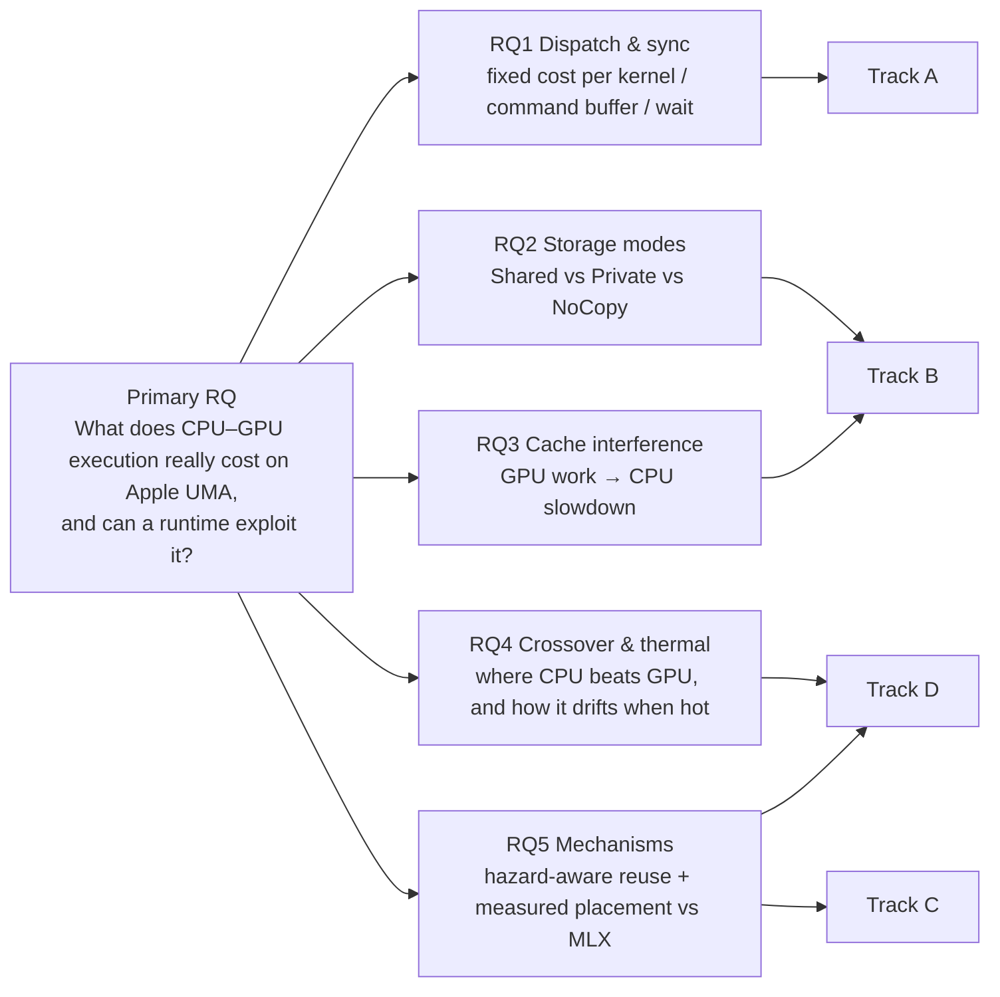
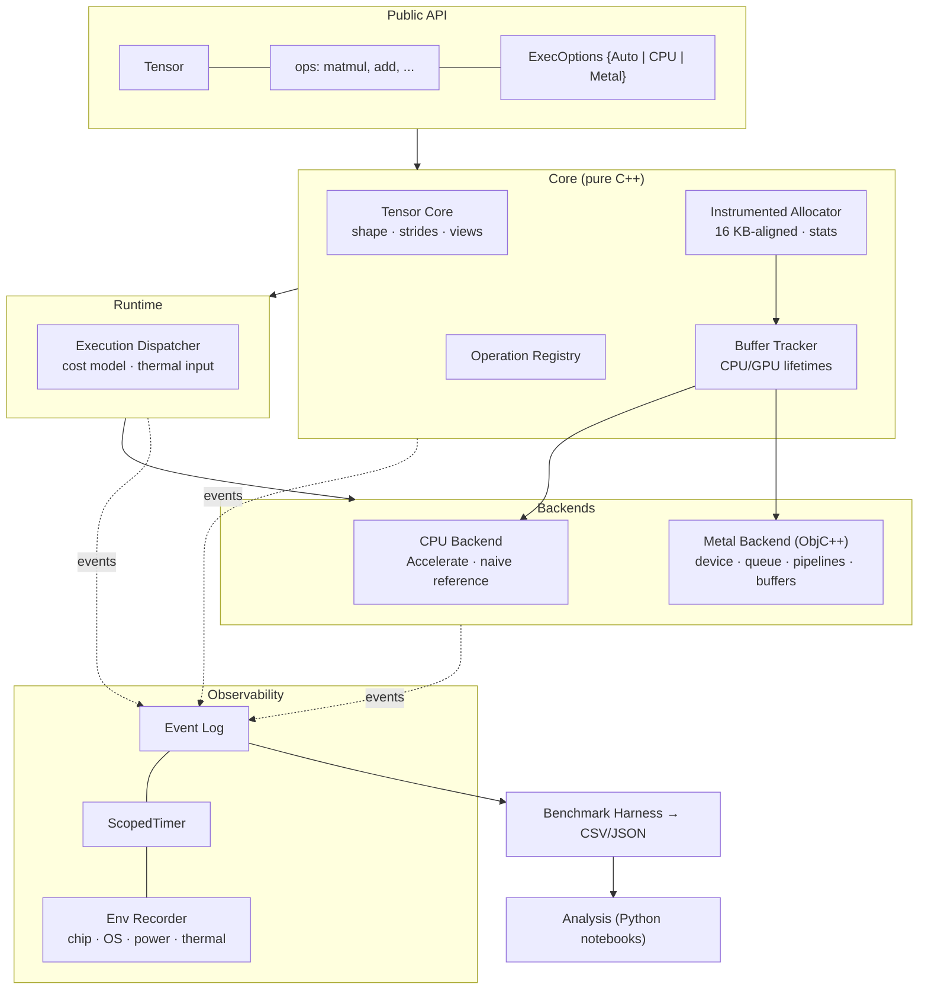
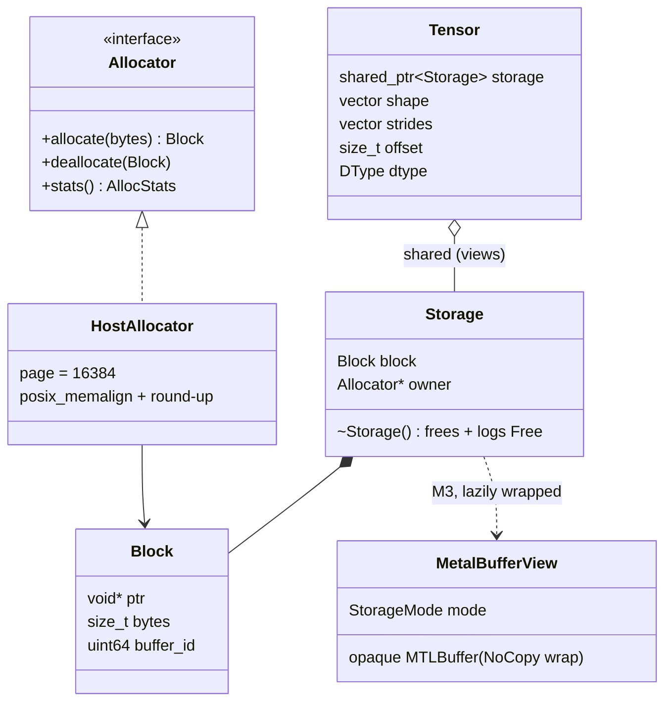
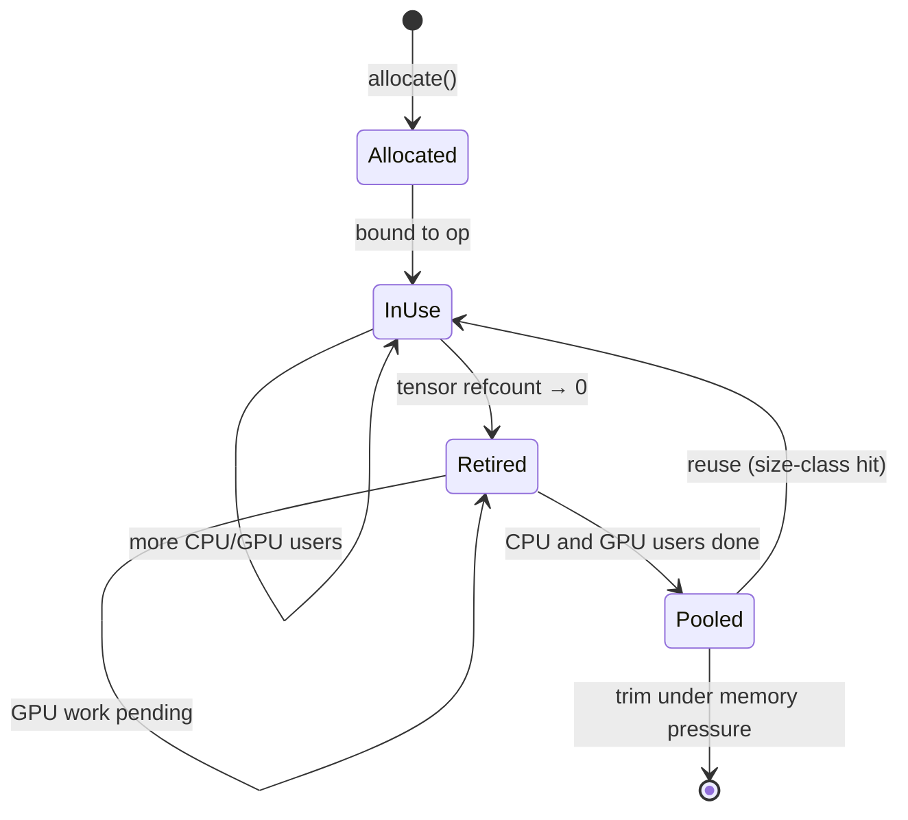
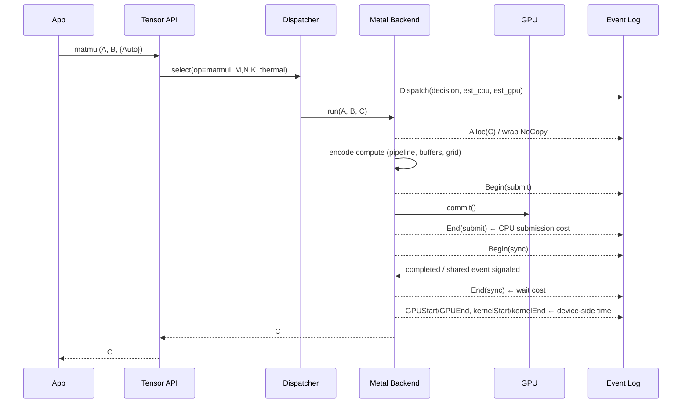
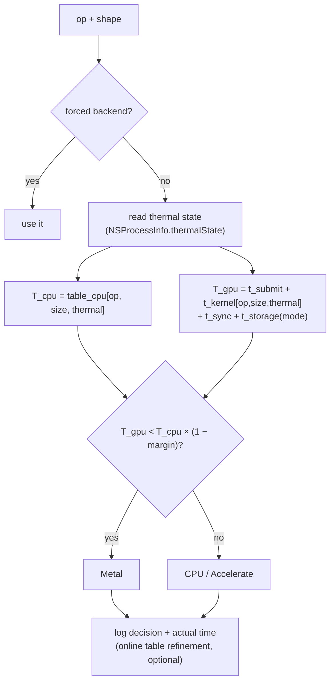
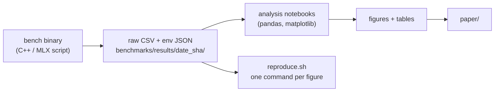
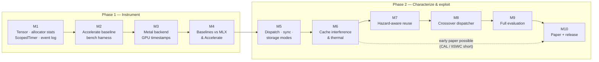

# ComputeEdge — Project Plan & Architecture

> **One line:** ComputeEdge is an instrumented C++ tensor engine used to measure, and then exploit, the real costs of
> CPU–GPU execution on Apple Silicon's unified memory.

| | |
|---|---|
| Platform | MacBook Air M4 (fanless), 16 GB unified memory, macOS |
| Languages | C++20 (core), Objective-C++ (Metal glue only), Metal Shading Language |
| Libraries | Apple Metal, Accelerate (baseline + reference), GoogleTest |
| Build | CMake + Ninja |
| Status | M1–M2 complete; M3 next |

---

## 1. Goals

| Type | Goal |
|---|---|
| Engineering | A small, correct, fully instrumented tensor engine with CPU (Accelerate) and Metal backends |
| Research (primary) | Characterize the dispatch, synchronization, storage-mode, cache-interference and thermal costs of CPU–GPU execution on Apple Silicon |
| Research (secondary) | Test whether those measurements can drive (a) hazard-aware buffer reuse and (b) crossover-based placement that beats framework defaults (MLX) on selected workloads |
| Academic | A reproducible short paper (IISWC short / IEEE CAL / EuroMLSys), with open benchmark code |

**Non-goals:** replacing MLX or PyTorch, beating Accelerate GEMM, training, conv/quantization/sparse/LoRA in the first paper, CUDA/ROCm, universal claims from one machine.

---

## 2. Research questions



| RQ | Hypothesis (to be tested, not assumed) | Falsified if |
|---|---|---|
| RQ1 | Per-dispatch + sync cost is tens of µs and dominates GPU time below ~512² GEMM | GPU wins at all measured sizes end-to-end |
| RQ2 | Shared/NoCopy avoids copies, but carries first-touch/allocation costs that Private avoids for GPU-only data | No measurable difference across modes |
| RQ3 | Large GPU working sets measurably slow the next CPU pass | CPU timings unchanged after GPU work |
| RQ4 | The CPU/GPU crossover point moves as the fanless Air heats up | Crossover is stable across thermal states |
| RQ5 | Measured placement + safe reuse beats static-CPU, static-GPU and MLX defaults on a mixed-size op sequence | No improvement over best static policy |

The CPU/GPU shared-buffer reuse gap is a **research hypothesis**, not a confirmed novelty claim (see `research/related_work.md`).

---

## 3. System architecture

### 3.1 Layered view



### 3.2 Dependency rules
- `core/` depends on nothing else in ComputeEdge and has no Apple frameworks. It is portable C++20.
- Objective-C++ lives **only** in `src/metal/`. Headers in `include/` expose no Objective-C types, using opaque handles instead.
- Backends depend on `core/`. `runtime/` depends on backend *interfaces* (`backend.h`), not on implementations.
- Instrumentation is a leaf: everything may call it, and it calls nothing.

### 3.3 Components

| Component | Responsibility | Key files | Milestone |
|---|---|---|---|
| Tensor Core | Shapes, strides, offset, FP32 storage, views, `contiguous()` | `tensor.h/.cpp` | M1 |
| Instrumented Allocator | 16 KB page-aligned alloc, size rounding, stats, buffer IDs | `allocator.h/.cpp` | M1 |
| Event Log / ScopedTimer | Timestamped events, RAII timing, CSV export | `instrumentation.h/.cpp`, `scoped_timer.h` | M1 |
| CPU Backend | Naive reference matmul; `cblas_sgemm` baseline | `src/cpu/` | M1–M2 |
| Benchmark Harness | Warm-up, repetitions, stats, env metadata | `src/benchmark/` | M2 |
| Metal Backend | Device/queue, runtime MSL compile, matmul kernel, buffers, GPU timestamps | `src/metal/` | M3 |
| Buffer Tracker | Per-buffer CPU/GPU outstanding-use tracking, safe reuse pool | `buffer_manager.mm` | M7 |
| Execution Dispatcher | Picks backend from measured cost tables + thermal state | `src/runtime/` | M8 |

---

## 4. Memory design

### 4.1 Ownership model



- Storage is **16 KB-aligned with page-rounded size**, so a single pointer is valid for both CPU access and `newBufferWithBytesNoCopy`. This makes zero-copy an experimental variable that can be switched on, not an architectural assumption.
- Views (`reshape`, `transpose`, slices) share `Storage`. The last reference frees it.
- Stats: allocs, frees, current bytes, peak bytes, reuse count, power-of-two size histogram.

### 4.2 Hazard-aware buffer lifecycle (Track C, M7)

A buffer is reusable only when **no CPU user and no GPU command buffer** still needs it. Graph position alone is not enough.



**Reuse condition:**
`refcount == 0 ∧ cpu_inflight == 0 ∧ gpu_completed_value ≥ buffer.last_gpu_submit_value`
GPU completion is tracked with one `MTLSharedEvent` per queue that is signaled monotonically, or with
`addCompletedHandler` as a fallback. Baselines for comparison: no reuse, naive reuse (unsafe, used only to show the
hazard), and wait-before-reuse (safe but stalls).

---

## 5. Execution flow

### 5.1 Matmul on Metal, with instrumentation points



Timeline decomposition used throughout the paper:

```
end_to_end = t_alloc + t_encode + t_commit + (t_queue + t_gpu_kernel) + t_wake/sync + t_post
             └─ CPU clock (CLOCK_UPTIME_RAW) ─┘   └─ MTLCommandBuffer GPU timestamps ─┘
```

### 5.2 Crossover-based dispatcher (Track D, M8)



The cost tables come from Track A/B/D measurements, interpolated in log-size. The dispatcher is evaluated against
**static CPU, static GPU, an offline oracle, and MLX defaults**.

---

## 6. Instrumentation

**Event schema** (one row per event, exported as CSV):

| Field | Type | Notes |
|---|---|---|
| `t_ns` | u64 | `clock_gettime_nsec_np(CLOCK_UPTIME_RAW)` |
| `type` | enum | Alloc, Free, Dispatch, Submit, Sync, Begin, End, Reuse |
| `id` | u64 | buffer id or op id |
| `exec_id` | u64 | groups the events of one operation |
| `bytes` | u64 | where applicable |
| `backend` | enum | None, CPU, Metal |
| `label` | str-id | interned short label |

- Disabled logging costs one relaxed atomic load per call. Overhead with logging enabled is measured and reported.
- `ScopedTimer` is RAII: it writes into a sink and/or emits Begin/End.
- **Env Recorder** runs once per benchmark run and records chip, model, macOS build, power source, thermal state, compiler, flags, git SHA and timestamp.

---

## 7. Experimental methodology

### 7.1 Experiment matrix

| Track | Experiment | Independent variables | Metrics |
|---|---|---|---|
| A | Empty-kernel dispatch | kernels per command buffer (1…1024), sync method | submit µs, wait µs, GPU-reported time |
| A | Sync mechanisms | `waitUntilCompleted` vs `MTLSharedEvent` wait vs completion handler | wake-up latency distribution |
| A | Cold vs warm | first call (pipeline compile, first touch) vs steady state | latency |
| B | Storage modes | Shared / Private (+blit) / NoCopy × size 16 KB…1 GB | alloc time, first touch, CPU r/w GB/s, GPU r/w GB/s |
| B | Alignment | page-aligned vs not (copy fallback) | alloc + bandwidth |
| B | Cache interference | GPU working set 16 MiB…1 GiB, then CPU pass | CPU slowdown % vs idle baseline |
| D | Crossover | GEMM 64²…4096², non-square; Accelerate vs Metal | end-to-end latency, GFLOP/s |
| D | Thermal drift | sustained 10–20 min loop, logging thermal state | GFLOP/s over time; crossover per thermal state |
| C | Reuse | op sequences with mixed CPU/GPU users | allocs avoided, peak bytes, stalls, correctness |
| C+D | End-to-end | mixed-size op chains (e.g. small MLP layers) | total latency vs static / oracle / MLX |

### 7.2 Protocol
- Warm-up ≥ 10 iterations **and** ≥ 200 ms (small ops otherwise run before clocks reach steady state; a 128² SGEMM measured 4–5× slower with a count-only warm-up); ≥ 30 measured repetitions; report **median, IQR, and 95% bootstrap CI**.
- Shader compilation is excluded from steady-state numbers and reported separately as cold start.
- GPU end-to-end numbers always include synchronization.
- Power: always on the adapter, with Low Power Mode off; the battery case is reported separately if at all.
- Thermal: cool down to `nominal` between runs (fanless). Every sample is tagged with thermal state.
- Fixed random seeds and identical inputs across backends. Results validated against Accelerate (FP32, rel. tol 1e-4).
- MLX comparison: same shapes/dtype; `mx.eval` boundaries documented; CPU and GPU streams both tested.
- Energy (`powermetrics`, sudo) is secondary and reported only if repeatability is acceptable.

### 7.3 Pipeline



### 7.4 Threats to validity
One machine and one chip, so we avoid universal claims and invite replication on other M-series parts. Thermal and
background noise are controlled with cooldowns, tagging and repetition. macOS/Metal versions change behaviour, so
versions are recorded. Timer resolution is mitigated by batching tiny ops. Our own kernels are less tuned than MPS/MLX,
so kernel time is separated from overhead and the claims are about overheads.

---

## 8. Roadmap



| Milestone | Exit criteria |
|---|---|
| M1 | Tests pass under ASan/UBSan; 16 KB alignment verified; events reconstruct alloc/free timeline; 2×2 example prints 19 22 / 43 50 |
| M2 | `cblas_sgemm` path matches the reference; harness emits CSV + env JSON with median/IQR/CI |
| M3 | Metal matmul correct vs Accelerate; submit/sync/GPU times logged separately |
| M4 | Baseline table: ComputeEdge CPU, ComputeEdge Metal, MLX (CPU & GPU streams) across 128²…4096² |
| M5–M6 | Figures for Tracks A and B plus thermal; go/no-go on the short paper |
| M7–M8 | Mechanisms implemented, with correctness tests (including a deliberate-hazard test) |
| M9–M10 | Full evaluation, `reproduce.sh`, preprint + submission |

**Decision gate after M6:** if the characterization alone is strong, submit a 4-page short paper (IISWC short / CAL)
before building M7–M8. If the dispatch costs turn out negligible, pivot Track D to thermal behaviour and report the negative result.

---

## 9. Repository layout (target, grown incrementally)

```text
include/computeedge/  tensor.h allocator.h instrumentation.h scoped_timer.h operation.h backend.h
src/core/             tensor.cpp allocator.cpp instrumentation.cpp
src/cpu/              matmul_naive.cpp matmul_accelerate.cpp
src/metal/            metal_backend.mm buffer_manager.mm kernels/matmul.metal
src/runtime/          execution_dispatcher.cpp
src/benchmark/        benchmark.cpp env_recorder.mm
tests/                tensor_ allocator_ instrumentation_ matmul_ backend_tests.cpp
benchmarks/           dispatch/ synchronization/ storage_modes/ cache/ crossover/ thermal/ mlx/ results/
research/             related_work.md research_questions.md experimental_methodology.md paper/
examples/             matrix_multiplication.cpp
docs/                 plan_and_architecture.md getting_started.md
```

---

## 10. Risks & mitigations

| Risk | Impact | Mitigation |
|---|---|---|
| Prior work (FusionML 2026, DaMoN '26) overlaps | Novelty rejected | Position on dispatch/sync/storage/thermal characterization on a fanless Air; cite and contrast explicitly |
| Own Metal kernel is slow | Unfair GPU comparisons | Separate kernel time from overhead; also measure MPS GEMM as a "tuned kernel" reference |
| Accelerate uses SME/AMX and is very fast | GPU looks worse | That is a finding; the crossover is measured against the strongest CPU path |
| Thermal noise on fanless Air | Irreproducible numbers | Cooldown protocol, state tagging, many repetitions, report distributions |
| No offline Metal compiler (CLT only) | Weaker profiling | Runtime `newLibraryWithSource:`; install Xcode for Instruments/GPU capture by M5 |
| Scope creep | Paper never ships | Matmul-first; decision gate after M6; optional extensions frozen |
| Unverified citations | Credibility | Verify every 2026 preprint, issue and venue detail before the manuscript |

---

## 11. Venues (check CFPs when results exist)

| Venue | Format | Why |
|---|---|---|
| IISWC short-paper track | 4 pp., archival | Built for workload characterization |
| IEEE Computer Architecture Letters | 4 pp. | One sharp finding (e.g. cache interference, sync cost) |
| EuroMLSys (EuroSys workshop) | 6 pp. | Engine + dispatcher story |
| SEC Edge Intelligence workshop | 6 pp. | Edge/on-device framing |
| ISPASS | Full paper | Later, expanded evaluation + open benchmark suite |
